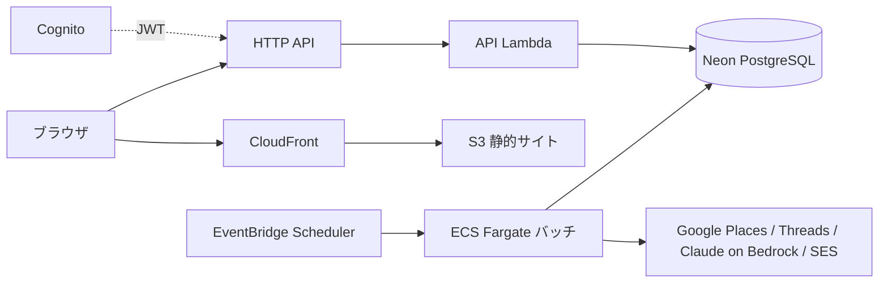

# 新店サロンウォッチャー v4

多摩地域26市の新規美容サロンを Google Map / Threads から収集し、根拠URL付きのリードとして通知する個人ツールです。最悪の失敗は「本当の新店を見逃すこと」です（判断の拠り所は [親設計書](docs/superpowers/specs/2026-10-18-salon-watcher-v4-design.md)）。

## 構成

| ディレクトリ | 内容 |
|---|---|
| `backend/` | TypeScript（Vitest, Drizzle + PostgreSQL）。バッチ CLI と API ハンドラ |
| `frontend/` | Next.js（静的書き出し） |
| `infra/` | Terraform（`modules/salon_watcher`、`envs/prod`、`tests/`）、補助スクリプト `scripts/` |
| `docker/`, `docker-compose.yml` | ローカル開発環境 |
| `legacy/gas-v3/` | 旧 GAS 版（参照用） |

バッチは Scheduler が ECS Fargate のタスクを起動して実行します（Lambda は API のみ）。当初の CDK + Step Functions + Lambda 構成からは、[開発環境・Terraform 設計書](docs/superpowers/specs/2026-10-18-dev-env-terraform-design.md)で移行しました。

## DB を VPC の外（Neon）に置く理由

- 本来は、DB を VPC 内（RDS 等）に置き、アプリも VPC 内からインターネットへは NAT ゲートウェイ経由で出る構成が望ましい（DB を外部に晒さず、通信経路を閉じられる）。
- しかし NAT ゲートウェイは**常時課金で月 $35 程度以上**（概算）かかり、効果を見極めている**観察期間**の個人ツールの費用としては見合わない。
- そこで観察期間中は、DB を VPC 外のマネージド PostgreSQL（Neon、TLS 接続、無料枠）に置き、バッチは公開サブネットのパブリック IP から直接外部へ出る。セキュリティグループは外向きのみ許可し、内向きは全拒否。
- **費用対効果が確認できたら**、RDS + プライベートサブネット + NAT の構成へ移行する（変更点: DB 接続文字列、タスクのサブネット、NAT の追加）。

## ドキュメント

- [開発ガイド](docs/development.md): Docker での開発環境、テスト、バッチのローカル実行
- [デプロイ手順書](docs/deploy.md): AWS / Neon / Meta の設定、デプロイ、AWS 上の通し確認、運用
- 設計書: [v4 設計](docs/superpowers/specs/2026-10-18-salon-watcher-v4-design.md)、[開発環境・Terraform 設計](docs/superpowers/specs/2026-10-18-dev-env-terraform-design.md)
