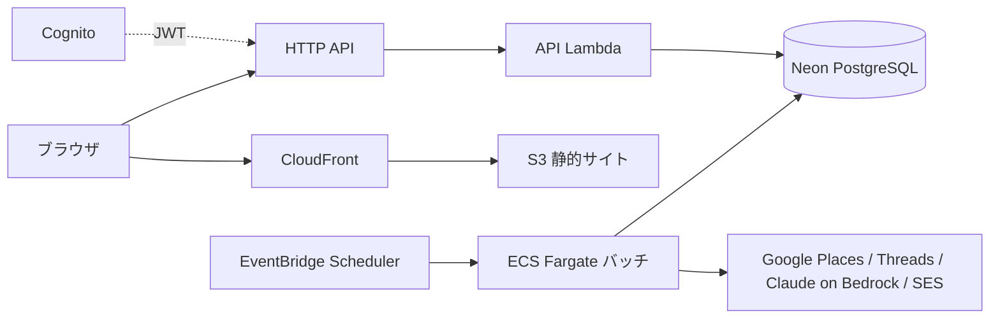

# 新店サロンウォッチャー v4

多摩地域26市の新規美容サロンを Google Map / Threads から収集し、根拠URL付きのリードとして通知する個人ツールです。最悪の失敗は「本当の新店を見逃すこと」です（判断の拠り所は [親設計書](docs/superpowers/specs/2026-10-18-salon-watcher-v4-design.md)）。

> [!IMPORTANT]
> **2026-11-08 に凍結しました。** 本番環境へのデプロイは一度もしていません。

## 凍結について

### 理由

v4 の主な目的は、Google Map より鮮度の高い SNS（Threads、のちに Instagram）から新店を見つけることでした。その取得手段の見込みが立たなかったため、凍結しました。

- **Threads 公式 API**: キーワード検索の権限 `threads_keyword_search` は、許可された用途が「ユーザー自身の SNS での発信の管理」と「集計・匿名化したデータの分析」に限られています。他人の投稿から個別の店舗を営業リードにするこのツールの用途は、どちらにも当たらず、App Review を通る見込みが低いと判断しました。
- **ログインせずに Threads を取得する方法（スクレイピング）**: 2026-11-08 に試作しました。1語のキーワードなら1回の検索で約20件取れ、投稿の URL・投稿者・投稿日時も取れます。ただし次の制約があります。新店の告知は反応が少なく上位に入りにくいため、見逃しを防げないと判断しました。
  - 並びは人気順で、「最新」を指定しても無視される
  - 空白区切りの複数語では0件になる
  - 画面を描画するブラウザ（ヘッドレス Chromium）が必要になる
  - Meta の規約にも反する
- **Google Map だけなら**: 旧 GAS 版（`legacy/gas-v3/`）を改良する方が、運用の手間と費用に見合います。AWS（ECS・Lambda・Cognito・SES・Bedrock）と Terraform を維持する理由がありません。

### 凍結時点の状態

- コード（バッチ CLI、API、フロントエンド、Terraform）とテストは master にあり、テストはすべて成功していました（backend 183、frontend 10、`terraform test` 11）
- AWS アカウントは作っていません。Neon プロジェクトと Meta（Threads）アプリは凍結時に削除しました
- 本番で一度も確かめていないこと（[デプロイ手順書](docs/deploy.md) の 9 章）:
  - Scheduler から ECS が起動されるか
  - Bedrock の IAM 条件（`bedrock-mantle:Model`）が実際のモデル ID と一致するか
  - Places API が日本語の住所を返すか

### GAS 版に持ち帰れる知見

- **全エリアの網羅**: Places API (New) の Text Search を IDs Only（FieldMask `places.id,nextPageToken`）で呼ぶと、無料枠の上限がありません。地域を格子に区切り、結果が上限（60件）に達した区画だけを4分割していく方式で、26市を網羅できます。課金されるのは詳細取得（Place Details）だけです（`backend/src/sources/googleMaps/`）
- **既知店の除外**: 区画ごとに、初回の検索で見つかった ID は既存店として記録だけし、通知しません。2回目以降に初めて現れた ID だけを新店候補にします（`sweep.ts`）
- **HPB 掲載チェック**: beauty.hotpepper.jp の検索結果を、店名と市で照合して判定します（`backend/src/hpb/`）

### 再開するには

SNS 側の状況（API の提供範囲、審査の方針）が変わったら、[デプロイ手順書](docs/deploy.md) の 0 章から進めます。Neon は作り直しになります（1 章）。

## 構成

| ディレクトリ | 内容 |
|---|---|
| `backend/` | TypeScript（Vitest, Drizzle + PostgreSQL）。バッチ CLI と API ハンドラ |
| `frontend/` | Next.js（静的書き出し） |
| `infra/` | Terraform（`modules/salon_watcher`、`envs/prod`、`tests/`）、補助スクリプト `scripts/` |
| `docker/`, `docker-compose.yml` | ローカル開発環境 |
| `legacy/gas-v3/` | 旧 GAS 版（参照用） |

バッチは Scheduler が ECS Fargate のタスクを起動して実行します（Lambda は API のみ）。当初の CDK + Step Functions + Lambda 構成からは、[開発環境・Terraform 設計書](docs/superpowers/specs/2026-10-18-dev-env-terraform-design.md)で移行しました。

## DB を VPC の外（Neon）に置く理由

- 本来は、DB を VPC 内（RDS 等）に置き、アプリも VPC 内からインターネットへは NAT ゲートウェイ経由で出る構成が望ましい（DB を外部に晒さず、通信経路を閉じられる）。
- しかし NAT ゲートウェイは**常時課金で月 $35 程度以上**（概算）かかり、効果を見極めている**観察期間**の個人ツールの費用としては見合わない。
- そこで観察期間中は、DB を VPC 外のマネージド PostgreSQL（Neon、TLS 接続、無料枠）に置き、バッチは公開サブネットのパブリック IP から直接外部へ出る。セキュリティグループは外向きのみ許可し、内向きは全拒否。
- **費用対効果が確認できたら**、RDS + プライベートサブネット + NAT の構成へ移行する（変更点: DB 接続文字列、タスクのサブネット、NAT の追加）。

## ドキュメント

- [開発ガイド](docs/development.md): Docker での開発環境、テスト、バッチのローカル実行
- [デプロイ手順書](docs/deploy.md): AWS / Neon / Meta の設定、デプロイ、AWS 上の通し確認、運用
- 設計書: [v4 設計](docs/superpowers/specs/2026-10-18-salon-watcher-v4-design.md)、[開発環境・Terraform 設計](docs/superpowers/specs/2026-10-18-dev-env-terraform-design.md)
